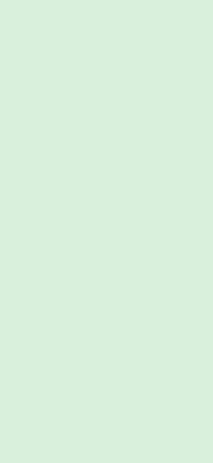
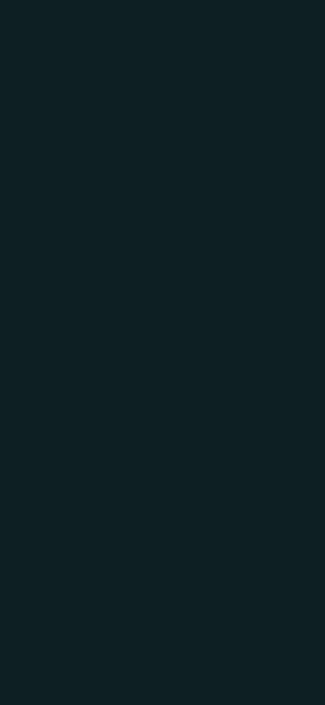

# SegundoAire

**Toma un segundo aire** · *Take a second breath*

🇪🇸 [Español](#español) · 🇬🇧 [English](#english)

  

---

## Español

### Qué es

SegundoAire es una app nativa de bienestar digital para Android 10 o superior. Cuando abres una app que elegiste vigilar, la intercepta y te muestra una pausa, el **GlassWall**, antes de dejarte entrar. No prohíbe nada: devuelve un segundo de conciencia para que decidas tú.

Funciona 100 % en el dispositivo. Ningún dato sale del teléfono y la app ni siquiera declara el permiso de Internet.

### Por qué existe

Mucha gente siente que el celular le quita tiempo de estudio, de sueño o de presencia, y quiere reducirlo sin un bloqueo total que termine desinstalando. SegundoAire parte de una idea sencilla: un momento de pausa, cálido y sin culpa, basta muchas veces para cambiar la decisión.

Es un proyecto de la materia *Diseño de Interfaces*, así que se diseñó y construyó como un producto real: cifras honestas con su fórmula visible, lenguaje sin regaños y accesibilidad desde el primer día.

### Cómo funciona el GlassWall

1. Un `AccessibilityService` escucha los cambios de ventana. Con cada cambio, el `InterceptorEngine` decide si el paquete en primer plano está vigilado. Esa decisión es O(1) sobre datos en memoria, sin E/S, para quedar por debajo de 50 ms.
2. Si hay que interceptar, el `OverlayWindowManager` dibuja el GlassWall en una ventana `TYPE_APPLICATION_OVERLAY` por encima de la app.
3. En Android 12 o superior el fondo se desenfoca con `FLAG_BLUR_BEHIND`. En Android 10 y 11, o con el desenfoque desactivado por el sistema, se usa un velo (scrim). El texto nunca depende del desenfoque para ser legible.
4. La entrada es calmada: primero el fondo, después el contenido. Verás un círculo de respiración y un mensaje con tu nombre y tu objetivo principal.
5. Tras elegir *Continuar*, la app no vuelve a interceptarse durante el tiempo de pausa configurado para ella.

### Mindful vs Strict

Los bloques de enfoque tienen dos niveles de rigor. Los nombres **Mindful** y **Strict** no se traducen.

| | Sin bloque activo | Bloque **Mindful** | Bloque **Strict** |
|---|---|---|---|
| **Volver** | Siempre disponible | Siempre disponible | Siempre disponible |
| **Continuar** | Disponible | Se habilita tras 10 s con la pausa a la vista | No existe hasta que el bloque termine |

Mindful te da un respiro y la última palabra; Strict te acompaña hasta que acabe el bloque que tú mismo empezaste. El timer se basa en el reloj de pared: sobrevive a rotaciones y a mandar la app al fondo.

### Qué incluye

- **Onboarding personalizado:** nombre, objetivos, uso diario y momentos de riesgo; una revelación con la fórmula visible, demo de respiración, plan y compromiso.
- **Panel:** saludo con tu nombre, dato del día, apps vigiladas con su interruptor y avisos de permisos.
- **Bloques:** duración, rigor y anillo de progreso continuo.
- **Progreso:** minutos recuperados, aperturas evitadas, racha y gráfico semanal.
- **Perfil y ajustes:** editar nombre y objetivos, idioma ES/EN dentro de la app, tema sistema/claro/oscuro, tutorial, modo demo y reiniciar app.
- **Accesibilidad:** contraste WCAG AA, áreas táctiles de 48 dp o más, TalkBack, fuente grande y *reducir movimiento*.

**Simulado:** login, registro, recuperación de contraseña y proveedores de cuenta (UI y validación completas, sin backend) y los mensajes de IA (un banco local detrás de una interfaz reemplazable). Todo lo demás es funcional.

### Permisos

| Permiso | Para qué |
|---|---|
| Servicio de accesibilidad | Detectar qué app pasa a primer plano. No lee el contenido de las apps. |
| Mostrar sobre otras apps (`SYSTEM_ALERT_WINDOW`) | Dibujar el GlassWall. |

La app los pide con un paso a paso guiado y funciona sin ellos mostrando avisos claros.

### Capturas

Las imágenes de `docs/screenshots/` son marcadores de posición; se reemplazan por capturas reales con el mismo nombre. Ver [`docs/screenshots/README.md`](docs/screenshots/README.md).

| | Claro | Oscuro |
|---|---|---|
| **Bienvenida** |  |  |
| **Panel** |  |  |
| **Bloques** |  |  |
| **GlassWall** |  |  |
| **Progreso** |  |  |
| **Perfil** |  |  |

### Stack

| Capa | Tecnología |
|---|---|
| Lenguaje | Kotlin 2.0, Java 17 |
| UI | Jetpack Compose (Single-Activity), design system propio, [Haze](https://github.com/chrisbanes/haze) para el vidrio |
| Arquitectura | Clean Architecture + MVVM con flujo unidireccional (`StateFlow`) |
| Datos | Room (esquema exportado y migraciones explícitas) y DataStore Preferences |
| DI | Dagger Hilt |
| Navegación | Navigation Compose |
| Idioma por app | `AppCompatDelegate.setApplicationLocales` + `locales_config.xml` |
| Motor de fondo | `AccessibilityService`, `InterceptorEngine`, `OverlayWindowManager` |
| Tipografía | Manrope (variable) |
| Plataforma | minSdk 29 · compileSdk y targetSdk 35 |

```
app/src/main/java/com/segundoaire/
├── di/            módulos Hilt
├── core/          servicio de accesibilidad, motor de intercepción, overlay
├── data/          Room, DataStore, repositorios
├── domain/        modelos, casos de uso, interfaces
└── presentation/  designsystem, onboarding, auth, setup, main, panel, blocks, progress, profile, overlay
```

### Cómo compilar

Requisitos: Android Studio reciente (o JDK 17+) y el SDK de Android 35.

```bash
gradlew.bat assembleDebug           # APK de debug
gradlew.bat testDebugUnitTest       # tests unitarios
gradlew.bat lint                    # lint
gradlew.bat connectedDebugAndroidTest   # tests instrumentados (emulador o dispositivo)
```

En macOS o Linux usa `./gradlew` en lugar de `gradlew.bat`.

> **JDK:** `gradle.properties` fija `org.gradle.java.home` al JBR de Android Studio en su ruta por defecto de Windows. Si tu instalación está en otro sitio, cambia esa línea o quítala. Si `lint` falla con un JDK demasiado nuevo, ejecútalo con un JDK 17–21: `gradlew.bat lint -Dorg.gradle.java.home="<ruta al JDK>"`.

#### Build de release

El build de release se firma con un keystore que **no** está en el repositorio:

1. Copia `keystore.properties.example` a `keystore.properties` (ya está en `.gitignore`).
2. Completa `storeFile`, `storePassword`, `keyAlias` y `keyPassword`.
3. Ejecuta `gradlew.bat assembleRelease`.

Sin `keystore.properties`, el build de release falla con un mensaje claro: nunca se firma con la clave de debug.

### Documentación del proyecto

- [`SEGUNDOAIRE_SPEC.md`](SEGUNDOAIRE_SPEC.md): especificación de producto.
- [`DESIGN_SYSTEM.md`](DESIGN_SYSTEM.md): tokens de color, tipografía, vidrio, espaciado y movimiento.
- [`ROADMAP.md`](ROADMAP.md): fases y tareas.
- [`CLAUDE.md`](CLAUDE.md): reglas de trabajo, Gitflow y convenciones de commits.
- [`CHANGELOG.md`](CHANGELOG.md): historial de versiones.

---

## English

### What it is

SegundoAire is a native digital-wellbeing app for Android 10 and up. When you open an app you chose to watch, it intercepts it and shows a pause, the **GlassWall**, before letting you in. It doesn't forbid anything: it gives you a moment of awareness so you decide.

It runs 100 % on the device. No data leaves the phone, and the app doesn't even declare the Internet permission.

### Why it exists

Many people feel their phone steals time from study, sleep or presence, and want to cut back without a hard lock that ends with the app being uninstalled. SegundoAire starts from a simple idea: a warm, guilt-free pause is often enough to change the decision.

It is a project for the *Interface Design* course, so it was designed and built like a real product: honest numbers with their formula in plain sight, no scolding tone, and accessibility from day one.

### How the GlassWall works

1. An `AccessibilityService` listens for window changes. On every change, the `InterceptorEngine` decides whether the foreground package is watched. That decision is O(1) over in-memory data with no I/O, to stay under 50 ms.
2. If it must intercept, the `OverlayWindowManager` draws the GlassWall in a `TYPE_APPLICATION_OVERLAY` window above the app.
3. On Android 12 and up the background is blurred with `FLAG_BLUR_BEHIND`. On Android 10 and 11, or when the system disables cross-window blur, a scrim is used instead. Text never relies on blur to be legible.
4. The entrance is calm: background first, then content. You'll see a breathing circle and a message with your name and main goal.
5. After you choose *Continue*, the app isn't intercepted again for the pause time configured for it.

### Mindful vs Strict

Focus blocks have two rigor levels. The names **Mindful** and **Strict** are not translated.

| | No active block | **Mindful** block | **Strict** block |
|---|---|---|---|
| **Go back** | Always available | Always available | Always available |
| **Continue** | Available | Enabled after 10 s with the pause on screen | Doesn't exist until the block ends |

Mindful gives you a breather and the last word; Strict stays with you until the block you started yourself is over. The timer is wall-clock based: it survives rotation and the app going to the background.

### What's inside

- **Personalized onboarding:** name, goals, daily usage and risky moments; a reveal with the formula shown, a breathing demo, a plan and a commitment.
- **Home:** greeting with your name, the day's figure, watched apps with their switch and permission notices.
- **Blocks:** duration, rigor and a continuous progress ring.
- **Progress:** minutes recovered, openings avoided, streak and a weekly chart.
- **Profile and settings:** edit name and goals, in-app EN/ES language, system/light/dark theme, tutorial, demo mode and reset app.
- **Accessibility:** WCAG AA contrast, 48 dp or larger touch targets, TalkBack, large fonts and *reduce motion*.

**Simulated:** login, sign-up, password recovery and account providers (full UI and validation, no backend) and the AI messages (a local bank behind a replaceable interface). Everything else is functional.

### Permissions

| Permission | Why |
|---|---|
| Accessibility service | Detect which app comes to the foreground. It doesn't read the apps' content. |
| Display over other apps (`SYSTEM_ALERT_WINDOW`) | Draw the GlassWall. |

The app asks for them with a guided walkthrough and works without them, showing clear notices.

### Screenshots

The images in `docs/screenshots/` are placeholders, to be replaced with real captures under the same names. See [`docs/screenshots/README.md`](docs/screenshots/README.md).

| | Light | Dark |
|---|---|---|
| **Welcome** |  |  |
| **Home** |  |  |
| **Blocks** |  |  |
| **GlassWall** |  |  |
| **Progress** |  |  |
| **Profile** |  |  |

### Stack

| Layer | Technology |
|---|---|
| Language | Kotlin 2.0, Java 17 |
| UI | Jetpack Compose (Single-Activity), in-house design system, [Haze](https://github.com/chrisbanes/haze) for glass |
| Architecture | Clean Architecture + MVVM with unidirectional data flow (`StateFlow`) |
| Data | Room (exported schema, explicit migrations) and DataStore Preferences |
| DI | Dagger Hilt |
| Navigation | Navigation Compose |
| Per-app language | `AppCompatDelegate.setApplicationLocales` + `locales_config.xml` |
| Background engine | `AccessibilityService`, `InterceptorEngine`, `OverlayWindowManager` |
| Typography | Manrope (variable) |
| Platform | minSdk 29 · compileSdk and targetSdk 35 |

### How to build

Requirements: a recent Android Studio (or JDK 17+) and the Android 35 SDK.

```bash
gradlew.bat assembleDebug           # debug APK
gradlew.bat testDebugUnitTest       # unit tests
gradlew.bat lint                    # lint
gradlew.bat connectedDebugAndroidTest   # instrumented tests (emulator or device)
```

On macOS or Linux use `./gradlew` instead of `gradlew.bat`.

> **JDK:** `gradle.properties` pins `org.gradle.java.home` to Android Studio's JBR at its default Windows path. If yours lives elsewhere, change that line or remove it. If `lint` fails on a JDK that is too new, run it with a JDK 17–21: `gradlew.bat lint -Dorg.gradle.java.home="<path to JDK>"`.

#### Release build

The release build is signed with a keystore that is **not** in the repository:

1. Copy `keystore.properties.example` to `keystore.properties` (already in `.gitignore`).
2. Fill in `storeFile`, `storePassword`, `keyAlias` and `keyPassword`.
3. Run `gradlew.bat assembleRelease`.

Without `keystore.properties` the release build fails with a clear message: it is never signed with the debug key.

### Project documentation

- [`SEGUNDOAIRE_SPEC.md`](SEGUNDOAIRE_SPEC.md): product specification (Spanish).
- [`DESIGN_SYSTEM.md`](DESIGN_SYSTEM.md): color, typography, glass, spacing and motion tokens (Spanish).
- [`ROADMAP.md`](ROADMAP.md): phases and tasks (Spanish).
- [`CLAUDE.md`](CLAUDE.md): working rules, Gitflow and commit conventions (Spanish).
- [`CHANGELOG.md`](CHANGELOG.md): version history (Spanish).
